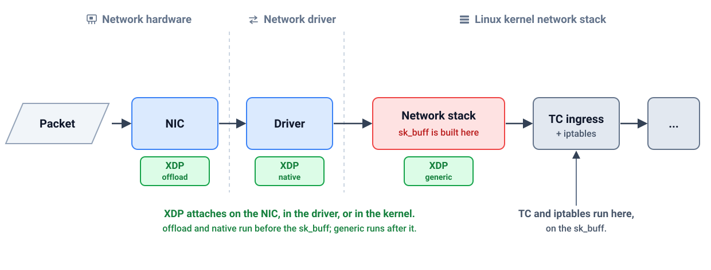

*AI use disclaimer: I used Claude Code to analyze the benchmark output, draft and review this write-up, and tidy my French syntax into English. The measurements are real runs, and the opinions, questions, and editorial choices are mine.*

Everyone repeats that XDP is cheaper than TC because it drops packets "earlier." I wanted the number, so I wrote the same packet drop two ways and measured it. On my first setup, a veth pair, XDP came out **1.7% slower**. That result is the whole point of this post.

The claim I was testing is simple: dropping unwanted traffic in XDP saves CPU because the kernel does less work. The thing nobody tells you is that "earlier" only means something when the drop happens *before the kernel builds the packet's metadata*. On the wrong interface, XDP drops the packet and still pays for most of the work.

---

## The experiment

Two eBPF programs, identical logic: drop UDP (User Datagram Protocol) packets destined for port 9999, pass everything else. One attaches to the **TC ingress** hook, the other to **native XDP** (`xdpdrv`). Same traffic: one million UDP packets.

XDP is the eXpress Data Path, the earliest point at which a BPF program can run on a received packet, down in the driver. Native XDP, the `xdpdrv` mode used here, means the NIC driver itself runs the program on the raw frame. When a driver has no XDP support, the kernel falls back to a generic mode that runs the program later, after the `sk_buff` is already built, which gives none of the savings below. TC is traffic control, the kernel's packet queueing and classification layer, where BPF programs attach through the `clsact` qdisc, a queueing discipline that queues nothing and exists only to host the tc ingress and egress hooks. The diagram below shows where each of these attaches.

```bash
# TC ingress
tc qdisc add dev veth0 clsact
tc filter add dev veth0 ingress bpf da obj tc.o sec tc

# native XDP (driver mode)
ip link set dev veth0 xdpdrv obj xdp.o sec xdp
```

The difference between the two is *where in the receive path the program runs*, and that decides how much work the kernel has already done by the time the program can drop the packet.



*Diagram 1: where XDP and TC attach in the Linux receive path.*

Native XDP runs in the driver, on the raw frame the NIC has just placed into a receive buffer. The NIC (network interface card) puts the packet there by DMA (Direct Memory Access), writing the bytes straight into memory without the CPU copying them. The program is handed an `xdp_md` context, which is a pointer to the packet bytes. It parses the Ethernet, IP, and UDP headers directly off that buffer, decides `XDP_DROP`, and the buffer is recycled. That is how native XDP is meant to work. Whether a given device delivers it, or instead hands XDP a packet the kernel has already wrapped in an `sk_buff`, is what Run 1 puts to the test.

TC ingress runs later, inside the kernel's receive path. By the time a TC program sees the packet, the kernel has already allocated an [`sk_buff`](https://docs.kernel.org/networking/skbuff.html), the metadata structure that lets the stack carry the packet (defined as [`struct sk_buff` in `include/linux/skbuff.h`](https://github.com/torvalds/linux/blob/v6.17/include/linux/skbuff.h)), and populated it. The TC program parses the same headers, this time through the `__sk_buff` context, and drops the packet. The parsing work is identical in both cases. The difference is the `sk_buff` the kernel had to build to reach the TC hook, which is the work XDP never did.

To see how much stack work each one triggers, I use [`bpftrace`](https://github.com/bpftrace/bpftrace) to count how often the receive core runs during the flood:

```text
bpftrace -e 'kprobe:__netif_receive_skb_core* { @stack = count(); }
             kprobe:cls_bpf_classify*          { @tc = count(); }
             kprobe:veth_xdp_rcv_skb*          { @xdp = count(); }'
```

Under TC the kernel's receive path runs once per packet, a million times. Under XDP it runs almost never, because XDP already dropped the packets in the driver before they could reach the stack. The packets are still received and dropped either way. What changes is how much the stack has to do about it.

```
# TC                      # XDP
@stack: 1000000           @stack: ~100
@tc:    1000000           @xdp:   1000000
```

So XDP keeps the packets out of the stack, and the reasonable next assumption is that it therefore saves CPU. That assumption is where the story falls apart.

---

## Run 1: veth, packets out of the stack but no cycles saved

The first setup runs the demo exactly as the repo ships, with no changes. Its `make setup` builds a `veth` pair, XDP and TC attach to it, and 1M packets are sent from a network namespace. Measured on a laptop (AMD Ryzen 7 PRO 8840HS, kernel 6.17).

Here is what the table shows. `stack skbs processed` is how many packets reached the kernel's receive path, and `skbs built and freed` is how many `sk_buff` structures were allocated. `cycles / packet` and `instructions / packet` are the CPU work spent per packet, where lower is better. `BPF program time` is the time spent inside the eBPF program itself. The last column is the XDP result relative to TC.

| metric | TC | XDP | |
|---|---|---|---|
| stack skbs processed | 1,000,000 | ~100 | |
| skbs built and freed | 1,000,000 | 1,000,000 | |
| cycles / packet | 23,864 | 24,263 | **+1.7%** |
| instructions / packet | 27,323 | 27,862 | +2.0% |
| BPF program time | 38 ns | 42 ns | |

Each row maps to a concrete measurement:

- *stack skbs processed*: `bpftrace` count on `kprobe:__netif_receive_skb_core`
- *skbs built and freed*: `bpftrace` counts on `kprobe:__alloc_skb` and `kprobe:kfree_skbmem`
- *cycles / packet* and *instructions / packet*: `perf stat -e cycles,instructions`
- *BPF program time*: `run_time_ns / run_cnt` from `bpftool prog show`, with BPF statistics enabled

XDP kept a million packets out of the receive stack and still cost slightly more.

The reason is in the "skbs built and freed" row: **both built a million**. `veth` is a software device. When the peer transmits, the packet is already an `sk_buff`, and the veth receive path hands that skb to XDP by converting it ([`veth_convert_skb_to_xdp_buff`](https://elixir.bootlin.com/linux/latest/ident/veth_convert_skb_to_xdp_buff)). The allocation happened before XDP ran. XDP skipped the stack's *receive processing* but not the allocation, and the conversion added a little work of its own. "Out of the stack" is not the same as "no work done."

Here is the veth path, with XDP running after the `sk_buff` already exists:


*Diagram 2: on veth, the `sk_buff` is built before XDP runs.*

On a real NIC like virtio-net, XDP runs on the raw frame first, so the `sk_buff` is never built:


*Diagram 3: on virtio-net, XDP drops the raw frame before any `sk_buff` exists.*

This is not specific to my setup. The [Cilium XDP documentation](https://docs.cilium.io/en/latest/reference-guides/bpf/progtypes/#xdp) describes the same behavior for virtual devices: on a device like veth the kernel operates on an `sk_buff`, so XDP cannot act before the allocation, and the generic-mode fallback is limited anyway. Generic XDP bypasses cloned skbs, which the TCP stack relies on heavily to hold segments for retransmission, and it has to linearize the whole skb first. For skb-based paths like this, tc BPF is the better fit, because it is built around the `sk_buff` context from the start.

---

## Run 2: virtio-net native XDP, dropping before the skb exists

The laptop's physical NICs don't support native XDP, so the second setup moves XDP and TC onto a `virtio-net` NIC inside a KVM (Kernel-based Virtual Machine) guest, with traffic arriving from the host over a tap. On `virtio-net`, native XDP runs in the driver on the received frame **before** an skb is built.

Chris Tarazi ran these on bare-metal Linux, where the hardware PMU, the CPU's Performance Monitoring Unit that holds the cycle and instruction counters, is available and the cycle counts are real.

The rows are the same as before, with two throughput rows added. `max drop rate` is the most packets per second (pps) each program can drop before the receive CPU saturates, and `cycles / drop at max rate` is the CPU cost per packet at that ceiling. A higher drop rate and a lower cost are better.

| metric | TC | XDP | |
|---|---|---|---|
| skbs built | 1,000,000 | ~100 | |
| cycles / packet | 8,462 | 6,058 | **−28%** |
| instructions / packet | 6,327 | 4,099 | **−35%** |
| max drop rate | 1.47M pps | 2.06M pps | **+40%** |
| cycles / drop at max rate | 2,870 | 1,710 | −40% |
| BPF program time | 57 ns | 54 ns | |

This time XDP drops the packet in the driver, so the kernel never builds the `sk_buff` at all, and the saving appears right away: 28% fewer cycles per packet, and 40% more packets dropped per second before the receive CPU saturates. The BPF program itself costs essentially the same in both cases, 57 ns and 54 ns, so the difference is not the program but the receive-path work the kernel never does, because XDP decided in the driver before any `sk_buff` was allocated.

A note on how to read these numbers: compare TC against XDP *within* the same run, not the absolute values from one run to another. Run 1 was measured on the sender's pinned CPU on the bare laptop, and run 2 on the guest's receive vCPU where VM overhead inflates the raw values, so the absolute cycle counts are not comparable between the two runs. The TC-versus-XDP gap inside each run is the signal.

The flame graphs show the same gap from the CPU's side. Both profile the virtio-net run with `perf`, where the width of a frame is how much on-CPU time was spent in it. They are interactive: click a frame to zoom in, and press Ctrl-F to search.

<object type="image/svg+xml" data="flame-virtio-tc.svg" aria-label="TC flame graph: the kernel builds the sk_buff and walks __netif_receive_skb_core before cls_bpf_classify drops the packet" style="width:100%; aspect-ratio:1200/662; border:0;">TC flame graph</object>

*Diagram 4: TC flame graph. The `sk_buff` is built and the receive path walked before `cls_bpf_classify` drops.*

Under TC, follow the receive path left to right: `napi_alloc_skb` and `napi_build_skb` build the `sk_buff`, `__netif_receive_skb_core` walks it up the stack, and only then does `cls_bpf_classify` run the program and drop the packet. All of that width is work the kernel spends before the drop.

<object type="image/svg+xml" data="flame-virtio-xdp.svg" aria-label="XDP flame graph: the virtio driver runs the program and drops the frame, with no receive-path tower and no sk_buff" style="width:100%; aspect-ratio:1200/518; border:0;">XDP flame graph</object>

*Diagram 5: XDP flame graph. The driver drops the frame, with no receive-path tower and no `sk_buff`.*

Under XDP, that tower is gone. The driver path `virtnet_poll` to `receive_buf` to `virtnet_xdp_handler` runs the program (`xdp_drop_udp`) and drops the frame directly. There is no `__netif_receive_skb_core` and no `sk_buff` allocation. The width that disappeared is the ~28% of cycles from the table.

---

## Why you probably can't measure this on your cloud VM

Cycle counts come from the PMU, so you can only read them where the PMU is exposed to the kernel doing the measuring. On bare metal, or in a KVM guest with a virtual PMU, `perf stat -e cycles` returns real numbers. On a standard public-cloud VM, or on the Lima VM I run this demo on (a Linux guest on my Mac), the hypervisor hides the PMU and `perf stat -e cycles` returns `<not supported>`.

| Environment | Hardware cycles? |
|---|---|
| Bare-metal Linux | yes |
| KVM guest with a virtual PMU | yes |
| Public-cloud VM (standard instance types) | usually no |
| Apple Silicon via Virtualization.framework (Lima, UTM) | no |

When you can't read cycles, you can still measure the work. The `__netif_receive_skb_core` count from earlier needs only kprobes and no PMU, so it runs anywhere and still shows XDP keeping a million packets out of the stack. That is why the cycle numbers in this post come from bare metal, while the skb count is the part you can reproduce on any machine, including your own laptop VM.

---

## This is the mechanism running in production

The same trick, an XDP program on the NIC that decides before the stack builds the skb, is what [Cilium](https://github.com/cilium/cilium) runs at the node edge. One use is load balancing: Cilium can attach an XDP program to the node's physical NIC that picks a backend for incoming service traffic and forwards it, in the driver, before an `sk_buff` is built. Traffic that is only passing through the node to reach a backend never pays for the full receive path, and the same hook drops unwanted traffic the same way. Cilium is a CNCF graduated, community-governed project, and in a public-cloud Kubernetes cluster the node is itself a VM, so native XDP on the node's NIC gives the same drop-before-the-skb benefit shown here.

The percentages above are my microbenchmark on a UDP drop, not a Cilium figure, and the mechanism is what carries over, not the exact numbers. And it carries over with a familiar footnote: the cluster gets the CPU benefit, but you often can't put a cycle counter on it there, because the node VM hides the PMU. That's why these numbers were taken on bare metal.

---

## What actually saved the cycles

Both programs drop the same packets. The CPU you save is the receive-path work the kernel never does, and the kernel only skips it when the driver runs XDP before allocating the `sk_buff`. On `veth`, the skb is already built, so XDP keeps packets out of the stack and saves nothing. On a real driver like `virtio-net`, XDP drops before the skb exists and takes 28% of the per-packet cycles with it.

The cheapest packet to process is the one you decide not to build. XDP does not make the work faster; it removes the work entirely, as long as you run it in the right place.

The code, the Makefile, and the raw results are at [github.com/doniacld/save-cpu-ebpf](https://github.com/doniacld/save-cpu-ebpf). Run `make all` on a Linux box; on bare metal you'll get the cycle numbers, on a cloud VM you'll get `<not supported>` and the skb count instead, which tells its own half of the story.

---

## Further reading

- [Cilium 1.8: XDP-based load balancing performance](https://cilium.io/blog/2020/06/22/cilium-18/)
- [XDP load balancer, a hands-on lab by Twodor](https://labs.iximiuz.com/tutorials/xdp-load-balancer-700a1d74) on iximiuz Labs
- [XDP: a gentle introduction](https://www.datadoghq.com/blog/xdp-intro/) (Datadog)
- [XDP program type reference](https://docs.cilium.io/en/latest/reference-guides/bpf/progtypes/#xdp) (Cilium BPF docs)
- [Cilium: network and application security with BPF and XDP](https://www.slideshare.net/slideshow/dockercon-2017-cilium-network-and-application-security-with-bpf-and-xdp/75142762) (DockerCon 2017)

*Thanks to Chris Tarazi for running the benchmarks on his bare-metal Linux machine.*
